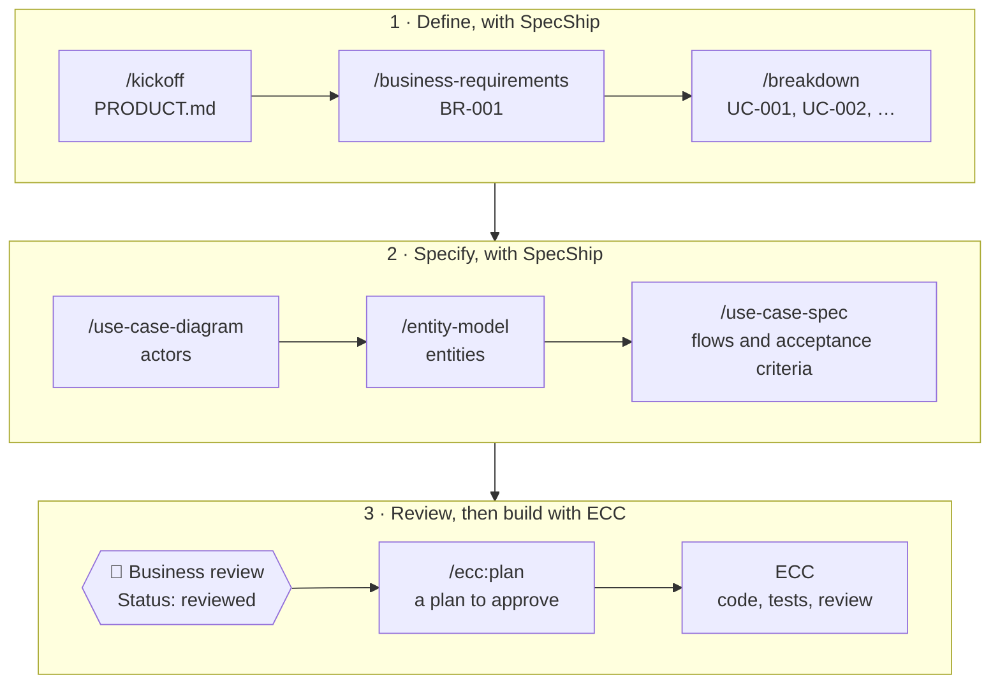

# SpecShip

**Spec to ship: spec-driven development for Claude Code.**

SpecShip turns what you know about your product into specs that people and AI both read: business requirements, use
cases with acceptance criteria, and an entity model, as Markdown files in your repository. Once a use case is
specified and reviewed, [ECC](https://github.com/affaan-m/ECC) turns it into tested, reviewed code.

> Status: 0.11.0, in development. Paths and formats can still change between versions.

## Why

An AI agent writes a feature in minutes. A few weeks later a user hits a case nobody remembers deciding: was it in the
request, did the AI infer it, or was it a requirement everyone forgot? Ask the AI and it answers with confidence, and
differently each time. The code is still there; the intent behind it is gone.

SpecShip keeps the intent in the repository. Before the AI writes code, you write down what you want, clearly enough
that the AI can build it, a new developer can follow it, and someone from the business who never reads code can say
"yes, that is what we need".

## How it works



Every step works the same way:

- **It grills you.** One question at a time, each with a recommended answer, only on what your files leave open or
  vague. What they already state, it takes without asking.
- **It writes its file when the grilling ends.** No approval round: the grilling was the review.
- **It names the next step.** Back after a break? `/next` reads the project and tells you where you stand.

## Install

SpecShip writes the specs; ECC builds from them. Install both in Claude Code:

```text
/plugin marketplace add affaan-m/ECC
/plugin install ecc@ecc

/plugin marketplace add tungbi811/SpecShip
/plugin install specship@specship
```

Update with `/plugin marketplace update specship`.

## Quick start

### A new product

| Step | Run | You get |
|------|-----|---------|
| 1 | `/kickoff` | `PRODUCT.md`: purpose, users, goals, scope, constraints, and success measures |
| 2 | `/business-requirements` | `BR-001`, the first release: goal, success metrics, in scope, and out of scope |
| 3 | `/breakdown` | One file per use case of BR-001, metadata filled in, every other section a template |
| 4 | `/use-case-diagram` | The actors and the use cases they take part in, as a Mermaid diagram |
| 5 | `/entity-model` | The nouns of the use cases: meaning, attributes, states, relationships, and rules |
| 6 | `/use-case-spec UC-001` | UC-001 filled in: trigger, flows, exceptions, and acceptance criteria in Given/When/Then |
| 7 | A person | Someone from the business side reads UC-001 and sets its Status to `reviewed` |
| 8 | `/ecc:plan specs/use-cases/UC-001-clock-in-and-out.md` | A plan to approve, then code, tests, and review |

Repeat steps 6 to 8 for each use case. The next release starts again at step 2: `/business-requirements "<name>"`.

### A project that already has code

1. `/kickoff` reads your README and source tree before it asks anything.
2. `/reverse-engineer <context>` writes down what one bounded context does today. Entities come from the database and
   use cases from the code, each a `draft` with its source and a confidence: `clear`, `guessed`, or `unverified`.
   What the code cannot answer becomes `TODO: verify with the business`.
3. Someone from the business side checks each use case: the code says what the system does, not what it should do.
4. Protect today's behavior with characterization tests, then refactor with `/ecc:orch-refine-code`. New features
   start at `/business-requirements`.

### Any time

- `/next` shows where the project stands and names the next command. Read-only.
- `/grill-me` interviews you about any plan until it is clear.

## What you get

```text
PRODUCT.md                         the product: purpose, users, goals, scope
specs/
  business-requirements/
    BR-001-mvp.md                  one per release or initiative
  use-cases/
    README.md                      the use case diagram
    UC-001-clock-in-and-out.md     one per use case
  entities/
    entity-model.md                or <context>.md, one per bounded context
  glossary.md                      optional; every step reads it when it exists
docs/                              not SpecShip's: ADRs, runbooks, and the plans ECC writes
```

Every file is plain Markdown and every diagram is Mermaid: GitHub and the VS Code preview render them with nothing to
install.

A use case ends in acceptance criteria concrete enough to test. From `UC-002-request-leave.md`:

```markdown
### AC-2: Start date in the past (E1)
Given: today is 2025-03-15
When: the employee requests leave from 2025-03-10
Then: the request is rejected with "Leave cannot start in the past"
And: no LeaveRequest is created
```

## Use case status

SpecShip writes every use case as `draft` and never changes its Status after that. People do, after a review.

| Status | Means |
|--------|-------|
| `draft` | Written by SpecShip, waiting for a business review |
| `reviewed` | Someone from the business side confirmed it; ready to build |
| `implemented` | Built and tested |
| `deprecated` | No longer used |

When a reviewed or implemented use case changes, it goes back for review, and the tests of the changed criteria follow.

## Implement with ECC

1. `/ecc:plan specs/use-cases/UC-001-clock-in-and-out.md`
2. Read the plan, then reply `yes`, or `modify: …`
3. ECC implements the plan
4. `/code-review`
5. Commit: `feat(UC-001): …`

When a business question comes up that the use case does not answer, update it with `/use-case-spec UC-001` first,
then continue.

Every step leaves a link back: a BR lists its use cases, a use case names its BR, tests are named after acceptance
criteria (`AC-1`), and commits after use cases (`feat(UC-001): …`). From a line of code you can walk back to the
business reason for it.

## Principles

- **Business language only.** Specs say what happens, not how: no screens, APIs, tables, or data types.
- **Never guess.** What no file backs is a question, not an assumption.
- **People own the Status.** SpecShip drafts; the business confirms.
- **One model, grown by every release.** Each BR adds to the same entity model and diagram instead of starting over.
- **Specs live with the code.** In `specs/`, versioned with the code they describe.

## This repository

- `.claude-plugin/marketplace.json`: the marketplace
- `specship/`: the plugin. Each skill's full instructions are in `specship/skills/<name>/SKILL.md`

## Credits

- Inspired by the Spec-Driven Development ebook by [Huy](https://huynt.dev), which draws on AI Unified Process, GitHub
  Spec Kit, and DDD.
- `/grill-me` comes from [mattpocock/skills](https://github.com/mattpocock/skills) (MIT).
- Implementation runs on [ECC](https://github.com/affaan-m/ECC).

## License

MIT. See [LICENSE](LICENSE).
